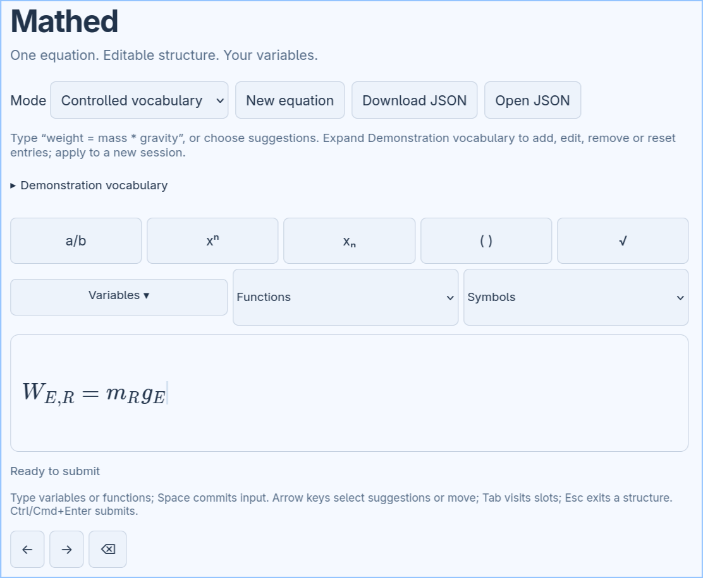

# Mathed



**A lightweight equation editor for the web — with editable mathematics, not just a picture of an equation.**

Mathed lets you write mathematical expressions using a keyboard or on-screen controls, then save them as structured JSON. Use it on its own or embed it in another application. No account, database, or backend service is required.

**[Try the live demo](https://jchristophm.github.io/mathed/)** · **[See the embedding example](https://jchristophm.github.io/mathed/examples/embedded.html)**

## What makes Mathed different?

- **Equations stay editable.** Fractions, exponents, subscripts, roots, functions, and other mathematical structures are stored as structured nodes, not flattened into an image or a LaTeX string.
- **Your variables can have identities.** In *controlled vocabulary* mode, an application supplies its own variables and persistent IDs. A displayed symbol can change without changing which variable the equation refers to.
- **Editing works inside expressions.** Move between nested slots with the keyboard, click or tap an insertion point, and use undo/redo while you work.
- **It fits into other applications.** Mathed is a reusable browser component with an API for loading drafts, updating variables, and receiving completed equations. The host controls saving and submission.

Mathed is an **editor**, not a symbolic algebra system: it preserves what the author entered rather than solving, simplifying, or checking the equation.

## Designed for AI-assisted learning

Mathed is designed with AI-assisted educational software in mind. Traditional equation editors primarily capture how mathematics *looks*. Mathed also preserves what mathematical expressions *mean* through structured JSON and variables with persistent semantic identities.

This allows AI agents to distinguish quantities that share similar symbols, recognize relationships between physical concepts, and interpret a student's mathematical reasoning in context. Rather than reconstructing meaning from a rendered equation or LaTeX string, an AI agent can work directly with an explicit representation of the student's intended mathematical structure.

**Mathed does not interpret or evaluate mathematics itself.** Instead, it provides a semantic foundation that educational applications and AI agents can use to deliver more context-aware feedback, identify misconceptions, and support student reasoning.

## How does Mathed compare to Desmos?

[Desmos](https://www.desmos.com/calculator) uses a sophisticated MathQuill-derived editor ([DesQuill](https://github.com/desmosinc/desquill)) that makes entering mathematical expressions intuitive. Its public calculator API exchanges expressions as LaTeX, with an emphasis on mathematical evaluation and graphing.

**Mathed takes a different approach.** Instead of using LaTeX as its document format, it stores equations as structured JSON, with individual mathematical elements represented explicitly. More importantly, variables can carry **persistent identities independent of their displayed symbols**. This allows an application to distinguish physical quantities, rename variables, and preserve their meaning across editing sessions.

Mathed is not intended to replace Desmos as a calculator or graphing tool. It is designed as a lightweight, embeddable equation editor for applications where the **structure and identity of mathematical expressions matter as much as their appearance**.

## Try it

The [interactive demo](https://jchristophm.github.io/mathed/) includes two modes:

| Mode | What you can do |
| --- | --- |
| **Standalone** | Type free-form mathematics, such as `cos(x) + 2`, and insert structures using the toolbar. |
| **Controlled vocabulary** | Build equations from a supplied list of variables. Try entering `weight = mass * gravity` to see how variable names map to persistent IDs. |

Use **Space** or **Enter** to commit typed input. Arrow keys move through the expression, **Tab** moves between nested slots, and **Esc** exits a structure. The demo also lets you inspect the underlying JSON, download an equation, and reopen it later. In controlled mode, expand **Demonstration vocabulary** to try renaming or removing a variable without changing the saved equation's references.

## Run locally

Requires Node.js 22 or newer.

```sh
git clone https://github.com/jchristophm/mathed.git
cd mathed
npm ci
npm run dev
```

Open the local address printed by Vite.

## Embed Mathed

Build the reusable browser package:

```sh
npm run build
```

For a locally installed copy of the package (for example, with `npm install ../mathed` in your application), a minimal TypeScript integration looks like this:

```ts
import { createEditor } from '@jchristophm/mathed';
import '@jchristophm/mathed/style.css';

const editor = createEditor(document.querySelector('#equation')!, {
  onSubmit: document => console.log(document)
});
```

To supply variables, load saved documents, or manage more than one editor, see the **[integration guide](docs/INTEGRATION.md)**. Mathed is not currently published to npm.

## Documentation

- [Integration and variable vocabularies](docs/INTEGRATION.md)
- [Structured document format](docs/FORMAT.md) and [JSON schema](docs/document.schema.json)
- [Architecture](docs/ARCHITECTURE.md)
- [Example documents](examples/)

For development checks, run `npm test`, `npm run build`, and `npm run test:browser` (after installing Playwright's Chromium browser).

## Project status

Mathed is at an early **0.1.0** stage. It handles individual equations; it does not yet include a notebook, equation solver, LaTeX import, handwriting recognition, or Diagramed integration. Browser tests cover desktop and mobile emulation, but testing on physical mobile devices and with assistive technologies is still needed.

## License

Mathed is open-source software released under the **MIT License**. You are free to use, modify, and distribute it, including in commercial applications, subject to the terms of the license.

See [LICENSE](LICENSE) for details.
